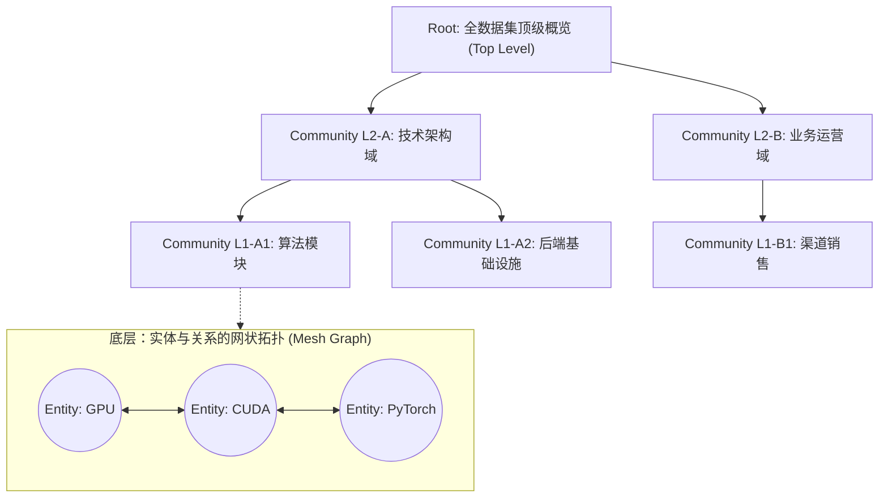
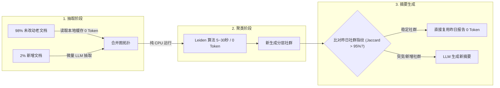
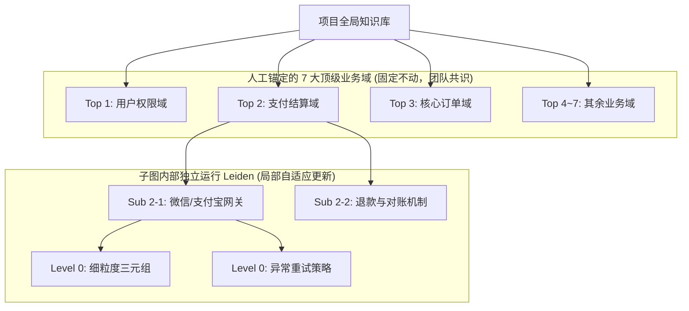

# 工业级分层知识图谱（Hierarchical GraphRAG）工程架构与落地指南 🕸️

> 本文系统梳理了分层知识图谱（Hierarchical Knowledge Graph）的核心机理、前沿改进方案、工程算账与企业级低成本落地架构。

---

## 目录
1. [核心概念：为什么必须是分层结构（Hierarchical）？](#1-核心概念为什么必须是分层结构hierarchical)
2. [前沿演进：从 Microsoft GraphRAG 到现代轻量化架构](#2-前沿演进从-microsoft-graphrag-到现代轻量化架构)
3. [工程精算：1,000 篇文档（500 万字）的成本与性能拆解](#3-工程精算1000-篇文档500-万字的成本与性能拆解)
4. [核心死穴剖析：为什么原版 GraphRAG 极难增量更新？](#4-核心死穴剖析为什么原版-graphrag-极难增量更新)
5. [最佳实践：分层缓存（Cache & Diff）与分治型架构落地](#5-最佳实践分层缓存cache--diff与分治型架构落地)
6. [技术选型与实施决策树](#6-技术选型与实施决策树)

---

## 1. 核心概念：为什么必须是分层结构（Hierarchical）？

### 1.1 传统 RAG 的两大死穴
* **纯向量检索（Vector RAG）**：擅长“大海捞针（局部点检索）”，但对于“跨全集宏观概括（全局主题）”完全失效（召回的 Top-K 碎片切片无法代表整体全貌）。
* **传统扁平知识图谱（Flat KG）**：实体全部扁平堆叠在同一平面。一旦知识库达到数十万节点，多跳检索（Multi-hop Traversal）将面临组合爆炸，噪音与幻觉急剧放大。

### 1.2 “宏观为树，微观为网”的设计哲学
Microsoft GraphRAG 的本质是一个**树状社群层次结构（Tree of Communities）**：



* **宏观表现为树（Tree）**：社群之间具有严格的自底向上包含关系。高层报告提炼宏观主题，方便 LLM 进行自顶向下的分级导航。
* **微观表现为网（Mesh Graph）**：每个 Community 内部由相互交织的实体（Entities）和关系（Relationships）构成，保留局部紧密的语义联想。

### 1.3 关键技术答疑
* **层数只有 2~3 层吗？**
  * **绝非固定！** 层数是自适应的。数据规模和图的密度越大，聚类树的深度越深。几十万节点的大规模图谱通常自然分化出 4~6 层深度。
* **如果某个底层（Level 0）社群依然很大怎么办？**
  1. **递归分裂（Recursive Sub-clustering）**：设定 `max_cluster_size` 阈值，超限则将该社群视为子图再次调用 Leiden 算法拆解；
  2. **提高分辨率参数（Resolution Parameter $\gamma > 1$）**：惩罚大型聚集，强制形成细粒度微小团簇；
  3. **度中心性剪枝（Centrality Pruning）**：生成报告时，优先保留连接最多、权重最高的骨干实体（Hub Nodes），舍弃边缘噪音。

---

## 2. 前沿演进：从 Microsoft GraphRAG 到现代轻量化架构

针对原版 GraphRAG 的沉重开销与检索死板，学界与工业界推出了针对性演进方案：

| 方案 / 论文 | 代表痛点 / 解决目标 | 核心机制 | 适用特点 |
| :--- | :--- | :--- | :--- |
| **Microsoft GraphRAG** *(Arxiv 2024)* | 传统 RAG 无法处理跨文档宏观总结 | Leiden 分层聚类 + 全层级自底向上预摘要 | 适合大型静态库离线宏观大盘分析 |
| **LightRAG** *(HKU, 2024.10)* | 建图成本极高、无法低成本增量更新 | 摒弃全局 Leiden 聚类；引入 Low/High 双粒度索引与局部实体合并 | **目前工程落地首选方案之一** |
| **HippoRAG** *(NeurIPS 2024)* | 多跳推理链路长、LLM 多步调用慢 | 类脑海马体设计：稠密向量种子 + 个性化 PageRank (PPR) 拓扑激活扩散 | 单步完成复杂多跳联想，延迟极低 |
| **DRIFT Search** *(Microsoft, 2024.11)* | Global 与 Local 检索模式割裂 | 顶层假设驱动 $\to$ 定向分支漂移（Drift）下潜取证 | 兼顾宏观主旨与微观精准证据 |
| **RAPTOR** *(ICLR 2024)* | 实体抽取脆弱且存在抽取幻觉 | 放弃三元组抽取，在 Embedding 空间直接做高斯混合递归聚类与文本树摘要 | 长篇文档结构化层级检索 |

---

## 3. 工程精算：1,000 篇文档（500 万字）的成本与性能拆解

### 3.1 数据基准
* **文档规模**：1,000 篇 $\times$ 5,000 字/词 $\approx$ 500 万字。
* **分块切片**：约 **8,000 ~ 10,000 个 Chunks**（按 600~800 Tokens/Chunk 计算）。

### 3.2 全量单次运行 Token 消耗明细
| 构建阶段 | 计算细节 | 预估消耗 Token |
| :--- | :--- | :--- |
| **1. 实体与关系抽取**<br>*(占总成本的 80%)* | 10,000 个切片，默认开启 1 轮反思（Gleaning）以防遗漏。<br>需调用 LLM 约 **15,000 ~ 20,000 次**。 | **输入**：约 2,500 万 ~ 3,000 万<br>**输出**：约 500 万 ~ 600 万 |
| **2. 实体描述合并与消歧** | 合并数千个唯一实体的同名描述。 | **输入/输出**：约 300 万 ~ 500 万 |
| **3. 分层社群报告生成**<br>*(Leiden Communities)* | 产生数百至上千个不同层级的社群，LLM 为每个社群写总结报告。 | **输入**：约 300 万 ~ 500 万<br>**输出**：约 100 万 ~ 200 万 |
| **全量单次总计** | — | **输入约 3,200 万 ~ 3,800 万 Tokens**<br>**输出约 700 万 ~ 900 万 Tokens** |

### 3.3 成本与时间对比
* **顶尖闭源模型（GPT-4o / Claude 3.5 Sonnet）**：
  * 单次成本：约 **$150 ~ $220 美元**（约合人民币 ¥1,100 ~ ¥1,600 / 天）。
  * 连续按天跑月成本：**¥3.5 万 ~ ¥5 万元人民币/月**（极昂贵）。
* **高性价比开源/国产模型（DeepSeek-V3 / Qwen-2.5-72B）**：
  * 单次成本：约 **¥50 ~ ¥120 元人民币 / 天**。
  * 连续按天跑月成本：**¥1,500 ~ ¥3,500 元人民币/月**（企业完全可接受）。
* **耗时预估**：受限于 API 限速（RPM/TPM），即便开 20~30 线程并发，全量重跑耗时通常在 **1 ~ 3 小时**。

---

## 4. 核心死穴剖析：为什么原版 GraphRAG 极难增量更新？

原版 Microsoft GraphRAG 设计时偏向于**静态文档全量索引**，直接执行增量会遭遇两大阻碍：

1. **拓扑雪崩（Cascading Re-clustering）**：
   * Leiden 是全局模块度优化算法。新增文档只要引入几个具有“桥梁（Bridge）”属性的关键实体，就可能改变全图的社群边界划分，导致成百上千个底层社群重构，并沿树状层次向上传导。
2. **社群报告级联失效（Summary Invalidation）**：
   * GraphRAG 的检索能力高度依赖预生成的各级 Community Reports。
   * 一旦社群边界变更，旧报告即刻失真。系统被迫重新调用 LLM 重写受影响的所有社群摘要，Token 再次发生连锁式消耗。

---

## 5. 最佳实践：分层缓存（Cache & Diff）与分治型架构落地

针对上述工程痛点，工业界沉淀出了两项核心解法：

### 5.1 方案 A：分层缓存（Cache & Diff）模式
**核心原则：未变文档不抽取，Leiden 算法 0 Token 纯算，社群摘要走指纹差异比对。**



* **效益评估**：
  * **抽取阶段省去 95%+ 的 Token**；
  * **Leiden 聚类在 CPU 上 30 秒内跑完（0 Token）**；
  * **总耗时从 3 小时骤降至 3~5 分钟，每日成本从几十元降低至几元钱**。

---

### 5.2 方案 B：本体引导的分治型架构（Ontology-Guided / 7大顶级域固化）
**核心原则：宏观顶层人为固定（团队共识），微观子图算法自治（隔离更新）。**

针对你提到的“人工固定 7 个顶级 Community（如 7 大业务域），只让子社群自动演进”的需求，具体实施三步法：



#### 实施步骤：
1. **第一步：建立顶层映射（锚定归属）**
   * **文档元数据路由（首选）**：1,000 篇文档按业务分类归入 7 个目录，抽出的实体天然继承所在领域的 Top 标签；
   * **种子实体/标签传播（备选）**：为 7 个顶层领域设定种子概念，其余实体通过图邻近度或向量相似度归属到对应域。
2. **第二步：子图独立聚类（图切分计算）**
   * 不对大图跑全量 Leiden，而是**将大图切分成 7 个物理/逻辑独立的子图**。
   * 每个子图内部单独跑 Leiden，自动推导下辖的 Level 1、Level 0 社群。
   * *(跨域的关系边依然保存在图库中，支持多跳检索，但不参与聚类的边界划分)*。
3. **第三步：故障与重算隔离（爆炸半径锁死在 1/7）**
   * 某天仅“支付结算域”新增了文档，**其余 6 个大类完全冻结，0 计算、0 Token！**
   * 仅局部重新计算“支付域”的子图聚类与子摘要。

#### 核心收益对比：
* **业务绝对保真**：完全符合团队业务规范与统一语言，避免无监督算法将风马牛不相及的概念硬聚在一起；
* **爆炸半径极小**：任何改动影响范围被严格锁死在当前业务域内；
* **检索精准路由**：提问时可根据关键词或意图直接路由到指定顶层分支检索，准确率与推理质量大幅提升。

---

## 6. 技术选型与实施决策树

```
你的知识库业务场景？
│
├── 场景 A: 快速开发、文档频繁流式新增、重视低成本
│   └── 推荐方案: 【LightRAG】或【HippoRAG】
│
├── 场景 B: 严格的组织/业务大盘分析、有清晰的顶层分类共识（如 7 大业务域）
│   └── 推荐方案: 【本体引导的分治型 GraphRAG (方案 B)】
│
└── 场景 C: 一次性静态文档库（如历史归档年报、大型小说），需深度挖掘全局主题
    └── 推荐方案: 【原生 Microsoft GraphRAG 全量离线构建】
```
